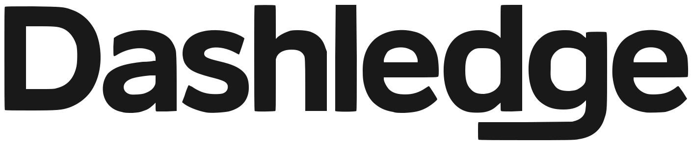

<h1> &nbsp;</h1>

**Put it on the ledge.** Dashledge turns the CORSAIR XENEON EDGE into a customizable touch dashboard for Mac. Give Apple Music the whole display, keep a Slack thread beside your calendar, or swipe to a page of live Mac and server metrics.

## Get started

1. Open the [releases page](https://github.com/dgruhin-hrizn/dashledge/releases) for available builds. For a Dashledge ZIP, expand it and move **Dashledge.app** to **Applications**. Quit an existing copy of Dashledge or its predecessor, Edge Workbench, before launching the new version.
2. Open **Settings → Pages & layouts**, add a page, and choose **Add widget**. Give one widget the whole screen or split the page into sections. Try the layout in **Live preview**.
3. In **General → Display**, select the EDGE and choose **Move to display**. Enable direct touch and grant Input Monitoring if macOS asks. Choose **Return to preview** to release the panel.
4. Swipe left or right to change pages. Over a carousel, start at either bezel. Tap the middle of the left edge or press **Option-P** for the page picker.

The menu-bar icon reopens Settings. You can also run the dashboard in a resizable window using **Show Window Preview**.

## What goes on the ledge?

| Widget | What you can see or do |
| --- | --- |
| Apple Music | Browse playlists by cover, search your library, and see what follows the current song in album or playlist order. Choose AirPlay speakers, adjust EQ, rate a track, or read lyrics saved with it. |
| Spotify | Browse playlists and recent plays, search for songs, add to the queue, switch playback devices, and watch a live audio spectrum. |
| Slack Workspace | Read mentions, direct messages, favorite channels, and thread replies in one full-screen view. Ten individual Slack widgets are also available for split layouts. |
| Mail & Calendar | Read recent Apple Mail or Spark Desktop inbox headers alongside your upcoming Mac calendar events. Filter individual calendars, swap the panes, and tap a meeting link to join. |
| Mac Shortcuts | Pin shortcuts from your Mac, choose each button’s color and icon, and arrange them in a different order on each page. Tap to run a shortcut and see when it finishes. |
| Apple Photos | Show your library, selected albums, or your iCloud Shared Photo Library on supported Macs. Choose Editorial montage, Instant prints, Filmstrip, Panorama gallery, or Daydream, where several photos drift and zoom across the screen. Set the speed and direction or tap to pause. |
| Mac instruments | Track CPU, GPU, memory, disk space, network throughput, power and thermals. Inspect individual network interfaces, mounted volumes, and Mac hardware details. Available counters depend on the Mac. |
| Emby | See active streams, artwork, and bitrates, and control playback. |
| Unraid | Check array health, storage activity, and containers. |
| Proxmox | Monitor cluster nodes, virtual machines, and guest GPU telemetry. |
| ComfyUI | Follow render queues and worker activity, and preview generated images. |
| oMLX | Watch live decode speed and inference history, and manage loaded models. |
| Ember Copper | View local workspaces, chats, plans, and usage. |
| Run-DMD | Turn the screen into a pinball dot-matrix clock with selectable animation groups and clips. |
| Everyday tools | Add local and world clocks, a focus timer, a scratchpad, or a widget backed by your own JSON endpoint. |

### Connect a service

In **Widget Studio**, open the widget’s settings, choose **Add connection**, enter the server details, and select **Test**. Pick that connection in the layout inspector. Saved credentials are protected by the macOS Keychain. Existing installations retain their layouts and the Keychain item named **Edge Workbench Connections**.

For Spotify playlists, search, and queue access, register `http://127.0.0.1:4848/callback` in your Spotify developer app. Select **Playlists → Connect Spotify** and enter the app’s Client ID. Allow system audio recording if you enable the spectrum analyzer. The Apple Music widget uses the Music app on this Mac. Allow macOS Automation access when prompted.

### Choose your Slack view

Open a Slack widget’s settings in **Widget Studio** and choose **Create workspace app**. Install the preconfigured Slack app in your workspace, copy its **User OAuth Token** from **OAuth & Permissions**, and paste it into **Connect workspace**. All eleven Slack widgets share that connection.

Use **Slack Workspace** for the full reader. For a split page, choose the widget that matches what you want to follow or control.

| To… | Add |
| --- | --- |
| Catch up on conversations addressed to you | Mentions or Direct Messages |
| Follow a channel, saved search, or single thread | Channel Watch, Keyword Watch, or Thread Monitor |
| Open a channel’s pinned items or saved links | Channel Pins or Channel Bookmarks |
| Find a coworker, set a timed status, or pause notifications | People Directory, My Status, or Quiet Hours |

### Set up Mail & Calendar

Add **Mail & Calendar** in Pages & layouts. Tap **Allow calendar access** on the widget. The agenda shows the next seven days from macOS EventKit. For calendars used in Spark, enable the same account under **System Settings → Internet Accounts → Calendars**. You can leave the Mail switch off.

Use the swap button beside **Calendar** to choose which pane comes first. Each placement remembers its own order. On narrow tiles the panes stack. Tap **Calendars** to show or hide individual calendars grouped by account. Each widget placement remembers its selection. Tap a date to filter the agenda.

In the **Inbox** pane, choose **Use Apple Mail** for the unified inbox, unread count, recent messages and compose. Approve the macOS Automation prompt to read inbox headers. Choose **Use Spark** to see the latest eight cached inbox messages and unread total across Spark accounts. Dashledge reads local message headers in read-only mode every 20 seconds while the mail view is visible. Tap a recent message to expand its header. Use pinned deep links to open specific conversations in Spark, or save recipients for one-tap compose. In Widget Studio you can switch clients or pin messages using Spark’s **Copy Deep Link** command.

### Load a Run-DMD card

Add **Run-DMD** to a page and tap the dot matrix to open its menu. Under **Animations**, load your own HDD Raw Copy Tool image (`.imgc`) or raw disk image (`.img`). Choose which groups can play, preview individual clips, or adjust the clock face, brightness, and playback interval. The original B134 animation artwork comes from the card you supply. The clock faces and panel effects are software recreations. Animation timing draws on [RunDMD-Utils](https://github.com/Pwedge/RunDMD-Utils).

### Add your own widget

Open **Widget Studio → Download example** for a ZIP containing a manifest, icon, and editing guide. Edit the package and use **Install package** to load it. Keep its package ID to update an existing widget.

## Development

Dashledge uses Rust, Tauri, and system WebKit. The Mac app bundles Node for its collectors. For local development, install Rust, Xcode Command Line Tools, and an official standalone Node 24+ distribution, then run:

```sh
npm ci
npm run dev
```

Develop each widget in its own Git worktree and branch from the latest `origin/main`. Test it there and open one pull request per widget targeting `main`. Once all widget PRs for the release have merged, sync a clean `main` checkout and run the following commands. You can run the signing step in a separate Mac Terminal session.

```sh
npm test
./scripts/package-mac.sh --prepare-only
./scripts/sign-mac.sh "$PWD/dist/Dashledge.app"
```

The signing script signs the app and its bundled runtime, verifies them, creates the release ZIP, and installs and opens the app. If you built in a custom output directory, pass the path to that directory’s app. For a personal build with a bundled Run-DMD card, set `RUNDMD_IMAGE` to your card image when preparing the bundle.

## Upstream credit

Dashledge began as a fork of **Josh Sorenson’s Edge Starter**. Its macOS HID touch handling and mapping of touch coordinates to the XENEON EDGE display form the basis of Dashledge’s touchscreen controls. The upstream MIT copyright and license are retained. You can also find the project links in **Settings → About**.

[Dashledge on GitHub](https://github.com/dgruhin-hrizn/dashledge) · [Edge Starter on GitHub](https://github.com/joshsorenson/edge-starter) · [MIT license](LICENSE)
